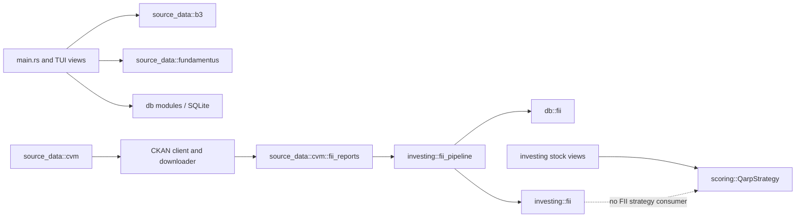

# MIDAS FII Readiness Audit

Audit scope: current working tree in `C:\dev\midas`, inspected on 2026-11-17. This is a repository audit, not an external validation of every provider endpoint. “Verified” means visible in code or exercised by a test/check; “inference” is called out explicitly. Existing unrelated working-tree modifications were present and were not changed as part of this audit. No implementation changes were made.

## 1. Executive Summary

MIDAS contains a real but narrow FII foundation: current B3 listed-fund browsing, current B3 details and Fundamentus snapshots in the TUI, typed parsing of CVM annual monthly-report archives, append-preserving SQLite observations, point-in-time query interfaces, and a small set of monthly metrics. The FII data path is separate from the stock QARP scorer.

It does not yet form an end-to-end historical research workflow. CVM quarterly, annual, and financial-statement packages are discoverable/downloadable but lack typed FII parsing and mappings. No market provider feeds the FII market store, no source adapter persists B3 distribution events, no IFIX history/universe is present, and no FII strategy, comparison report, or backtest consumes these data. The current B3 and Fundamentus UI views are snapshots, not historical databases.

The point-in-time store can answer “what had MIDAS recorded as available by time T” for stored observations. The monthly importer currently stamps every row in an annual archive with the archive resource’s `last_modified` time. A current archive cannot recreate old publication snapshots; consequently this supports conservative as-observed history from captured snapshots, not a complete historical information set for backtesting.

**Final answer: No.** The current implementation is not ready for reliable, reproducible end-to-end historical FII analysis. The single most important next task is a reproducible, persisted, point-in-time pipeline for one small cohort of FIIs that joins CVM filings, dated market prices, and distributions using validated identities and source availability timestamps.

## 2. Repository and Architecture Overview

The repository is a single Rust binary (`src/main.rs`, with modules declared there), backed by SQLite and a Ratatui TUI. The source integration layer is named `source_data`, rather than `data_sources`.

### Responsibilities and interaction

| Area | Verified responsibility | FII relationship |
|---|---|---|
| `source_data::cvm` | CKAN discovery, resource download, safe ZIP extraction, CSV decoding/parsing; company and fund adapters | `fii_reports.rs` discovers four FII report packages, but parses only the monthly archive |
| `source_data::b3` | Current listed FII list, security/issuer catalog, current issuer details, current distribution-like fields | Used by the TUI; no historical price or event persistence path |
| `source_data::fundamentus` | Scrapes current FII detail page and existing stock market/fundamentals data | FII detail is exposed as display strings, not normalized historical research data |
| `investing::fii` | Source-agnostic FII models and a cross-sectional percentile helper | Not connected to a UI analysis or strategy evaluator |
| `investing::fii_pipeline` | CVM monthly archive mapping, persistence, PIT retrieval, and limited metric calculation | Public functions exist, but no CLI/TUI ingestion entry point calls them |
| `db::fii` | SQLite observation tables and as-of filters | Schema initialized in startup (`main.rs`); source ingestion is not scheduled or invoked there |
| `scoring.rs` | Configurable stock QARP strategy and explainable stock score output | Uses stock-specific indicators and `StockFundamentals`; does not score FII models |
| `investments::fii_view` | Search/list current B3 FIIs, fetch B3/Fundamentus details | Snapshot browser only; not a historical analysis workflow |

The implementation sensibly reuses existing CVM download and archive utilities instead of duplicating transport. The FII research models are separate from UI/provider response types. Current duplicate/overlap is primarily about data intent: B3/Fundamentus details shown in the UI overlap conceptually with CVM report fields but are not normalized into the same domain/store. No concrete refactor is needed before the first pipeline; the missing integration is the immediate issue.

## 3. FII Domain Model Assessment

`investing::fii::FiiCategory` can name Tijolo, Papel, FOF, Hibrido, Desenvolvimento, and Outros. `ClassificationPeriod` supports valid dates, availability, and exposure fractions. **These are representational types only:** monthly ingestion stores reported `Mandato` and `Segmento_Atuacao` strings as metrics; it does not map them to a validated category or create `ClassificationPeriod` rows.

| Domain concern | State | Evidence / limitation |
|---|---|---|
| Stable fund identity | Partial | `FiiId` and CVM pipeline use normalized CNPJ; no persisted alias table linking CNPJ, B3/CVM codes, ISIN, and ticker history |
| Ticker changes, delisting, liquidation | Model only | `Fii` has optional ticker/listing/delisting/status fields; ingestion populates none of them |
| Category and subtype | Model only | Enum and dated exposure types exist; no classification pipeline or subtype model |
| Portfolio composition | Not represented as research records | CVM monthly asset/passive rows are preserved as filing JSON; properties, tenants, geography, receivables, and issuer exposure are not normalized |
| Shares/capital changes | Raw data only | Monthly complement is retained; no event/series model for issuance, amortization, or share count changes |
| Distributions | Partial | Domain supports declaration, ex-date, payment date, amount, type, reference period, publication/ingestion and revision; no provider integration, and persistence requires publication and payment timestamps/dates |
| Financial statements | Partial source infrastructure | FII financial statement package can be discovered/downloaded; no FII statement row mapping or normalized balance/income series |
| Leverage/liquidity | Raw data only | Monthly asset/passive source rows retained, but no metric mapping or validation |
| NAV and valuation | Limited | Monthly complement provides reported NAV/share and reported yield; P/NAV can be computed if a caller supplies an admissible raw price |

The enum covers the requested broad categories, but the data path cannot presently distinguish or analyze them. Category-specific metrics should not be pooled until validated mapping and strategy-specific eligible universes exist.

## 4. Data Sources Assessment

| Source | Coverage / granularity / history | Reliability, identity, updates, provenance, tests | Status |
|---|---|---|---|
| CVM CKAN (`source_data/cvm`) | Catalog and resource metadata; company, fund, and FII package discovery. `fii_reports.rs` names monthly, quarterly, annual, and financial-statement packages. | Shared downloader streams files; ZIP extractor rejects unsafe entries; CSV encoding/delimiter is explicit. Integration tests exist for CKAN metadata, company/fund adapters, some live endpoints. FII monthly parser fixture tests are small. | Functional shared infrastructure; FII family only partially functional |
| CVM FII monthly (`fii_reports.rs`, `fii_pipeline.rs`) | Annual ZIPs containing general, assets/liabilities, complement tables; monthly reference rows. Historical archive depth depends on CVM resource availability and downloaded snapshot. | CNPJ/date/version joins, preserves unknown source columns and raw values, stores source/dataset/version and timestamps. No fixture parses a complete ZIP with all three real tables; no captured multi-snapshot revision test. | Implemented narrow adapter; not operationally wired into the app |
| CVM FII quarterly / annual / DFIN | Package resources can be discovered and downloaded by year. | No typed parser, normalization, or storage mapping in the FII path. | Discovery/scaffolding only |
| CVM event filings | Generic CVM IPE/FRE/FCA disclosure support exists for companies; no FII event ingestion into this store was established by tests or call graph. | Do not infer that company filing support provides FII distribution/corporate actions. | Not demonstrated for FII research |
| B3 listed FII export and security catalog (`source_data/b3.rs`) | Current listed FII universe and issuer/security relationships. | CSV format fallbacks and a bundled listing fallback exist; current list is cached in `OnceLock`, with no refresh schedule or historical membership. Unit tests cover security catalog/list parsing; current details have live tests elsewhere only if enabled. | Functional current-data integration |
| B3 listed FII details | Current issuer/details response, including cash-distribution-like rows with payment date, label, rate, relation, ISIN. | Returned as provider response strings; the response type has no publication timestamp, stable event key, ex-date or normalized event semantics. TUI displays recent rows; no persistence. | Functional current display, not historical event source |
| Market price provider | Shared market-data/technical-analysis client exists for stock UI. | No FII adapter or mapping to `MarketObservation`, no historical adjusted-price semantics or availability timestamps in FII storage. | Not connected for FII |
| Fundamentus | Current scraped FII detail values including quote, yield, P/VP, NAV/unit, FFO, balance, property/vacancy summaries. | Scraper maps page labels to string pairs; no timestamped immutable snapshots or structured numeric validation in the FII path. Parser tests are present for stock/market list behavior, not a dedicated FII page fixture. | Current snapshot source, partially tested |
| IFIX | No adapter found for historical prices, constituents, or rebalancing membership. | No tests or persistence. | Not implemented |
| BCB / IBGE | No macro source adapter found in the repository. | No tests or persistence. | Not implemented |

### CVM format and revision findings

Verified in code: monthly CSV files are read as Windows-1252, semicolon-delimited records; each source cell is preserved as text before typed field conversion, and unknown columns remain in flattened maps. The archive parser expects filenames ending in the three annual member names. Monthly report matching uses normalized CNPJ, `Data_Referencia`, and `Versao`.

Limitations: tests exercise individual rows, not a full ZIP assembled from a representative downloaded archive; no regression fixtures cover schema drift, duplicate keys, malformed dates, unmatched table versions, or revision disappearance/correction. The report source resolver expects exactly one resource whose name contains the year and whose format matches. A year-name/resource catalog change can therefore fail instead of selecting by stronger resource metadata. DFIN format matching allows CSV and TXT labels but currently reports a “ZIP resources” error even for that dataset, which is a diagnostic wording defect, not proof the resource cannot be retrieved.

## 5. Historical Data and Point-in-Time Assessment

The model separates `reference_date`, `available_at`, and `ingested_at`; `db::fii::filings_as_of`, `market_observations_as_of`, and `distributions_as_of` filter by availability/publication time. Tests cover exclusion of later filing revisions, market availability, and distribution publication filtering. Monthly metric reconstruction selects one report version per reference date from observations visible at the requested `as_of` time.

Important limits and risks:

1. **Archive snapshot timing is not row publication timing.** `ingest_monthly_year` uses the resource’s CKAN `last_modified` for every row in the annual ZIP. `Data_Entrega` remains in payload and is only surfaced as a missing-date diagnostic. This is conservative relative to a captured archive, but can delay visibility of earlier filings until the whole archive’s latest modification and cannot represent when each version first became public.
2. **No archived snapshots, no historical availability reconstruction.** The first captured current ZIP only supplies the current archive contents and its current modification time. It cannot establish the historical state before MIDAS first captured a snapshot. Backfilling old data does not create an old as-of record.
3. **`ingested_at` is retained but not used in the as-of filter.** This is appropriate when `available_at` is independently trustworthy, but the timestamp quality is currently source-dependent and needs explicit policy/tests.
4. **Ticker/universe history is absent.** Current B3 listing is cached as a singleton for the process; there is no as-of ticker alias mapping, delisted fund registry, historical membership, or survivorship-controlled universe.
5. **Market prices and distributions are not ingested.** Schema support is not a historical dataset. Distribution model has relevant dates, but the current B3 payload does not provide a reliable publication timestamp or a complete event identity. `save_distribution` requires payment date and publication time; B3 current details are not passed into it.
6. **Corporate actions and total-return treatment are absent.** No return series joins prices, ex-dates, cash amounts, reinvestment, splits, amortizations, or adjustment conventions.
7. **Revision key/content semantics need refinement.** Filing uniqueness is `(fund, source, dataset, reference_date, revision_id)`. Re-ingestion ignores changes to availability/ingestion metadata if the payload is identical; conflicting payload for an existing revision is rejected. That avoids overwriting facts but does not record a later snapshot observation separately. Multiple reports sharing a revision label for the same identity would collide.

**Conclusion:** the storage API has PIT-shaped interfaces, but current capture semantics and absent historical market/event/universe data mean MIDAS is not suitable for unbiased point-in-time backtesting. A restricted as-observed CVM analysis is possible only for rows from snapshots actually captured, using their snapshot availability cutoff.

## 6. Indicator and Financial Correctness Assessment

There is no FII indicator registry or complete calculation layer. The implemented FII calculations are:

| Indicator | Formula / input | Frequency and applicability | Missing behavior / tests / limitation |
|---|---|---|---|
| NAV per share | Prefer source `Valor_Patrimonial_Cotas`; otherwise `Patrimonio_Liquido / Cotas_Emitidas` when both are positive | Monthly; potentially all categories, subject to source meaning | Missing or invalid becomes `None` with diagnostics; end-to-end fixture checks the reported-value path. Fallback assumes the source net assets and units are aligned and comparable; no independent reconciliation test |
| Reported monthly distribution-yield value | Parse `Percentual_Dividend_Yield_Mes` as finite numeric source value | Monthly source field; category coverage not established | Missing/invalid is `None`; value and unit are intentionally not inferred. Not annualized, not recomputed, not validated against paid distributions; unsuitable for cross-source yield comparison until convention is verified |
| P/NAV | `raw market price / NAV per share` | Caller-supplied market observation plus report NAV | Rejects mismatched fund, future availability or reference date; requires finite positive values. Fixture checks ratio. No market source is wired, price and NAV dates need not coincide beyond as-of bounds, and staleness is not constrained |
| FII percentile normalization | Mid-rank percentile over finite cross-sectional values; ties share averaged rank; one valid value gets 50; values scale 0–100 | Cross-sectional, not time-series; any metric only if caller supplies values | Skip preserves missing; RequireAll returns None when any missing. Tests cover ties, missing, nonfinite. No directionality, category grouping, weighting, composite score, or economic validation |

No implemented FII total return, price/distribution momentum, vacancy, coverage, leverage, delinquency, concentration, liquidity, macro exposure, or nominal/inflation adjustment. Existing indicators in `scoring.rs` are stock indicators (P/E, P/B, EV/EBITDA, ROIC, ROE, margins, leverage, growth, dividend yield), and should not be described as FII calculations.

Financial correctness is therefore limited rather than established. In particular, a raw monthly reported yield field is not equivalent to an investor’s trailing cash yield; P/NAV can be stale or mismatched in reference dates; and no source validates NAV/capital changes or distribution total return.

## 7. Scoring and Strategy Assessment

`scoring::ScoringStrategy` and `QarpStrategy` provide reusable stock scoring, configuration, indicator direction, weights, missing coverage rules, optional sector-relative calculations, and explainable per-indicator results. Tests cover eligibility, weighting, direction, missingness, stale quote handling, deterministic reports, and stock-specific edge cases.

The FII-side `percentile_scores` is only a normalization primitive. It does not accept a direction, category, weight, benchmark, date, or strategy config. There is no FII factor aggregator/evaluator, and the CLI `--score` path scores saved stock/Fundamentus snapshots using QARP.

| Strategy | Current state | Reason |
|---|---|---|
| Sustainable income | Not implemented | No validated distribution history, coverage inputs, ex-date logic, or payout sustainability model |
| Value / discount to NAV | Partially supported by primitive | NAV and optional P/NAV calculation exist; no price feed, peer universe, direction-aware score, or history |
| Quality | Not implemented for FIIs | Some raw monthly balance/report fields, but no normalized FII quality metrics or score |
| Price momentum | Not implemented | No persisted FII price series/calculator |
| Distribution-yield momentum | Not implemented | No dated consistent distribution series or PIT yield calculator |
| Macro-sensitive | Not implemented | No BCB/IBGE series or exposure mapping |
| Multi-factor | Architecture partly supported | Generic FII percentile helper exists, but no compositing strategy or explainability report |

The stock QARP score is not evidence of an FII strategy, and its stock-specific indicators must not be reused without FII-specific definitions and denominators.

## 8. Testing and Code Quality

Commands executed during this audit:

| Command | Result |
|---|---|
| `cargo test` | Passed: 92 tests, 0 failed |
| `cargo check` | Passed; compiler emitted warnings |
| `cargo clippy` | Passed with warnings; no lint denial/error |

FII-specific tests cover percentile normalization (`investing::fii`), synthetic archive ingestion/PIT/NAV/P-NAV and missing submission date (`investing::fii_pipeline`), typed monthly row parsing (`source_data::cvm::fii_reports`), filing revisions, market availability/price basis, and distribution publication filtering (`db::fii`).

Coverage gaps: no full realistic three-file ZIP parser fixture; no captured CVM schema/revision fixtures; no FII B3 event fixture; no FII Fundamentus parser fixture evident in its module tests; no tests for malformed/duplicate monthly table keys, multiple snapshots and correction visibility, market staleness/date alignment, adjusted-price treatment, delisted/universe membership, total return, or FII strategy outputs. Existing live CVM tests exercise separate data paths and depend on live service behavior; passing tests do not prove the full FII monthly download function works against a changing live archive.

Warnings are numerous (77 compiler warnings in `cargo check`, 120 Clippy warnings reported in the captured output), including unrelated unused imports/dead code/deprecations and the new pipeline’s unused production entry point. They do not fail the commands but make future regressions harder to distinguish. This audit did not modify or clean unrelated warnings.

## 9. End-to-End Workflow Assessment

| Workflow step | State | Evidence / missing dependency |
|---|---|---|
| 1. Identify a FII | **Partially ready** | Current B3 list and CNPJ-based CVM IDs exist; no persisted bridge between B3 ticker, CVM code, ISIN, CNPJ, and historical aliases |
| 2. Retrieve historical information | **Partially ready** | Annual monthly CVM archive download/parser exists; only one report family is mapped, snapshots are not retained as a managed history, and no market/events are fetched |
| 3. Normalize and store data | **Partially ready** | Monthly archive is mapped to append-preserving SQLite; raw tables are keyed/joined; other sources and report families do not flow into it |
| 4. Retrieve historical market prices/distributions | **Not ready** | Store methods exist, but no FII provider integration; B3 current details are display data only |
| 5. Retrieve/interpret CVM financial/regulatory info | **Partially ready** | Monthly FII tables parsed; quarterly/annual/DFIN mappings and FII filing event interpretation absent |
| 6. Calculate indicators | **Partially ready** | NAV/share, raw reported yield field, and optional P/NAV only |
| 7. Calculate investment scores | **Not ready** | Stock QARP exists; no FII strategy evaluator |
| 8. Compare comparable funds | **Not ready** | No normalized category exposure, historical universe or FII comparison view |
| 9. Produce explainable report | **Not ready** | Stock scoring report exists; no FII research output/report consumer |

## 10. Recommended First Complete FII Pipeline

Start with a small cohort of **three to five liquid Tijolo FIIs**, chosen only after validating current and historical identity coverage. This gives limited peer comparison without prematurely modeling all categories. Use two primary source families: CVM monthly archives for NAV/reporting and a historical market-data source plus dated distribution source for prices and cash events. Keep one real-estate segment cohort where possible; do not classify from ticker or names alone.

Acceptance scope:

1. Persist source snapshots/resources and fetch time, CKAN metadata, content hash, and source row version; retain each archive revision used in the study.
2. Build a validated alias bridge for CNPJ, CVM code, ISIN, and ticker with effective dates and provenance; record unresolved/ambiguous matches for review.
3. Ingest a small fixed cohort’s monthly CVM reports and market bars plus distributions with publication/ex/payment dates. Do not fill publication timestamps from payment dates.
4. Make PIT queries select only records actually public by the requested date; add fixtures for late filings, amended versions, corrections, and backfilled data.
5. Compute a small, clearly defined indicator set: monthly NAV/share, raw P/NAV with explicit quote date/staleness policy, and trailing cash distributions per share/yield based on ex-date eligibility and a price convention. Keep reported CVM yield separate from calculated yield.
6. Produce a deterministic, provenance-rich report showing source, reference date, available/ingested timestamps, values, diagnostics, and excluded data. Re-running against the same snapshots must reproduce the same output.

Reuse `CkanClient`, `ResourceDownloader`, `FiiMonthlyArchive`, `FiiId`, `FilingObservation`, `db::fii`, and existing SQLite patterns. First address the issues below around snapshot history, event identity/availability, market ingestion, and a runnable command/API entry point. This is more useful than expanding to FOF/Papel or adding many indicators immediately.

## 11. Prioritized Issues (P0–P3)

| Priority | Finding; evidence | Consequence | Recommended solution / dependency | Complexity |
|---|---|---|---|---|
| **P0** | Point-in-time availability is archive-level, not row-version-level (`ingest_monthly_year`, `Data_Entrega` retained but not used for availability); no historic archive snapshots are managed | Backtests cannot reconstruct the true historical information set; using current data with reference dates risks look-ahead | Capture immutable archive snapshots and metadata/hash on each retrieval; define a conservative, tested publication-time policy for each row/version, preserving uncertainty and not claiming pre-capture history. Needed before backtests | Medium |
| **P0** | No connected FII market series or dated distribution/corporate-action ingestion; store methods are otherwise unused by providers | No defensible total-return series, momentum, trailing yield, or market valuation history | Select providers and event schema; validate publication, ex, payment dates, adjustments, corrections, and identity. Needed for first complete pipeline | High |
| **P0** | No callable application workflow invokes `ingest_monthly_year` and then produces an analysis; `main.rs` initializes store but no FII ingest command/UI path calls the pipeline | The implemented foundation cannot be run end to end by a user from the app | Add a narrow explicit ingestion/research command after choosing sample cohort and source credentials; output reproducible diagnostics/report | Medium |
| **P1** | Identity is CNPJ-only in CVM and ticker-only in B3 view; there is no historical alias/effective-date store (`Fii`, B3 catalog, pipeline) | Merges can be missed or wrong across ticker/CNPJ/code changes; survivors dominate a current universe | Add sourced alias/effective-period records and ambiguity checks before joining B3 prices to CVM filings | Medium |
| **P1** | Monthly-only FII normalization; quarterly, annual, DFIN and portfolio detail data are not mapped (`fii_reports.rs`) | Cannot analyze financial statements, property/credit exposure, leverage, or deeper portfolio quality | Extend after first pipeline with representative fixtures and typed/source-preserving mappings | High |
| **P1** | FII metric limitations: no validated yield semantics, date alignment/staleness policy for P/NAV, no category-aware factor scoring | Reported field may be misinterpreted; comparisons can be financially invalid | Document/verify CVM units, implement explicit date/price rules, category eligibility and directional factor config before scores | Medium |
| **P1** | Historical universe, delisted funds and classification exposure are not persisted | Survivorship bias and cross-category comparison bias | Persist dated membership/classification and define point-in-time eligible peer sets | Medium |
| **P2** | Monthly parser tests are row-level/synthetic; no full archive, schema drift, correction, or matching edge fixtures | Source changes or malformed joins can silently break or lose observations | Add actual-schema archive fixture and edge/regression tests; report unmatched rows and duplicate keys as ingestion errors/diagnostics | Medium |
| **P2** | Fundamentals FII scraper returns display strings; not immutable/provenance-rich research records | Current values are hard to reproduce and cannot support history | Keep as a secondary cross-check; normalize into sourced observations only with stable capture dates and field definitions | Medium |
| **P2** | Many compiler/Clippy warnings and unused pipeline entry point | Noise obscures meaningful warnings and signals incomplete integration | Address touched warnings and establish warning baseline after pipeline command is operational | Low–Medium |
| **P3** | IFIX and macro history absent | Benchmark-relative and macro-sensitive strategies unavailable | Add only after base market/event pipeline is validated | Medium–High |

## 12. Proposed Development Roadmap

1. **Critical correctness and operational entry point:** freeze source snapshots with hashes/metadata; decide and test monthly availability semantics; define alias matching; add a narrow command to run ingestion and emit provenance/quality diagnostics.
2. **First complete FII data pipeline:** three-to-five validated Tijolo FIIs; monthly CVM plus dated market bars and distribution events; SQLite persistence; reproducible as-of analysis and data-quality report. Add late filing/revision tests before using historical results.
3. **Data coverage expansion:** implement quarterly/annual/DFIN and category-relevant portfolio data; add historical classification, ticker aliases, delisted funds, and IFIX constituents.
4. **Indicator and scoring validation:** define exact formulas, units, date alignment, missingness, category universes, directionality and explanation. Keep stock QARP separate.
5. **Backtesting readiness:** verify complete PIT snapshots/universe, total-return/corporate-action treatment, transaction costs, liquidity constraints, reproducible data versions and leakage tests. Do not backtest before this gate.
6. **Portfolio and strategy development:** only after data/indicator gates, add income/value/quality/momentum/macro strategies, portfolio construction, risk controls and performance reports.

The first two steps are immediate. Strategy and portfolio work is premature until source/event history is reliable.

## 13. Final Readiness Assessment

**Is the current MIDAS implementation ready to support a reliable, reproducible, end-to-end historical analysis of Brazilian FIIs? No.**

MIDAS has a useful monthly CVM ingestion foundation, current-data browsing, and point-in-time-shaped persistence interfaces, but they are not assembled into a runnable analysis workflow. Historical market prices, dated distributions/corporate actions, historical identities/universe, broad CVM financial data, and FII scoring/reporting are missing. Archive-level availability also cannot reconstruct the historical information set before MIDAS captured each revision.

**Single most important next development task:** deliver and validate one runnable, provenance-rich, point-in-time pipeline for a small fixed FII cohort that joins captured CVM archive revisions with historical market prices and dated distributions, then emits a reproducible basic analysis report.
